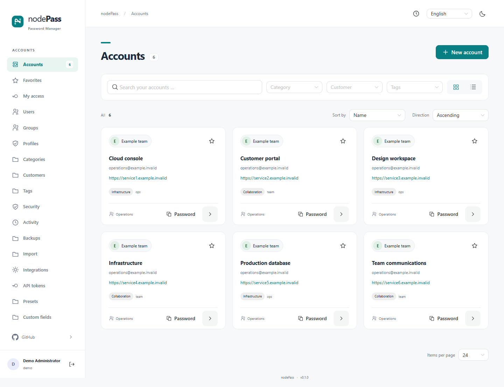

# nodePass


**A self-hosted password manager and migration-focused successor to sysPass.**

nodePass preserves the familiar sysPass account and permission model while replacing the PHP application with a TypeScript API and a modern Vue interface. It is designed as a drop-in replacement for a **one-time migration**, retaining configuration, account IDs and the original 27 base-table definitions, with additive `nodepass_` tables. It also supports fresh installations.

Compatibility has been tested against **sysPass 3.2.11**, schema `310.19042701`. Migration changes stored data and encryption state: sysPass and nodePass must never write to the same database concurrently. Returning to sysPass requires restoring the pre-migration backup into a separate database. See the [migration guide](docs/MIGRATION.md).

## What it does

### Familiar sysPass capabilities

- Accounts with search, categories, clients, tags, favorites and linked accounts; card and table views.
- Users, groups, profiles, private accounts and detailed permissions for metadata, passwords, files, history and sharing.
- Password generation and expiry, history and restoration, custom fields, attachments and presets.
- Expiring public sharing links with retrieval limits, including existing sysPass link addresses.
- CSV, KeePass XML and encrypted sysPass XML import/export; a separate instance migration workflow.
- Legacy JSON-RPC clients and existing action-bound API tokens, subject to the same authorization as the UI.
- LDAP/Active Directory, reverse-proxy sign-in, SMTP, syslog, wiki integration, activity records and notifications.

### Additions and modernizations

- Passkey sign-in with device PIN or biometric verification, multiple passkeys and one-time recovery codes.
- Built-in TOTP enrollment and MFA policy enforcement; administrators require MFA by default. sysPass already supported TOTP through its Authenticator plugin; nodePass integrates it into the application.
- Argon2id for new login passwords, upgrading valid legacy hashes on sign-in, and configurable login password length/strength requirements. The defaults for new or changed passwords are 15 characters and strength 3/4.
- A server-managed encrypted keyring: users no longer need a separate master-password activation. The old master password is checked once during migration.
- A responsive interface with a light default theme, a graphite dark theme and 14 languages.
- Authenticated encrypted backups, deployment-key rotation, container deployment and automated verification gates.

See the [feature comparison](docs/FEATURES.md) and [compatibility limits](docs/COMPATIBILITY.md). PHP plugins are not executed. Existing Authenticator 2.2 data has a specific migration path; other plugin data is retained without promising equivalent functionality.

## Interface



[Dark theme](docs/screenshots/accounts-dark.png) · [Mobile view](docs/screenshots/accounts-mobile.png)

## Try it locally

Install **Node.js 24 with npm** and start Docker Desktop with Linux containers, or Docker Engine with Compose v2. From this repository's root:

```sh
npm run preview
```

Open **http://localhost:3000**, use the setup token printed in the terminal, create your administrator and enroll a passkey or TOTP. There are no default credentials. No prior `npm install` or manual `.env` file is needed. On Windows, use `npm.cmd` if PowerShell blocks `npm.ps1`.

```sh
npm run preview:stop
npm run preview:logs
```

Stopping preserves data and generated secrets. The preview uses its own Compose project, localhost-only HTTP and persistent volumes. Use synthetic data or a separate copy of an existing installation. See [preview details and reset behavior](docs/INSTALLATION.md#local-preview).

## Documentation

| Guide                                  | Use it for                                                            |
| -------------------------------------- | --------------------------------------------------------------------- |
| [Installation](docs/INSTALLATION.md)   | Preview, fresh installation, Docker Compose, Coolify and Dokploy      |
| [Migration](docs/MIGRATION.md)         | Existing configuration/database, SQL dumps, preflight and recovery    |
| [Operations](docs/OPERATIONS.md)       | Configuration, integrations, backup/restore, key rotation and updates |
| [Releases](docs/RELEASES.md)           | Release candidates, verified images, publication and upgrade policy   |
| [Features](docs/FEATURES.md)           | Inherited, modernized and added capabilities                          |
| [Compatibility](docs/COMPATIBILITY.md) | Tested reference version, formats and legacy API behavior             |
| [Security model](docs/SECURITY.md)     | Trust boundaries, controls and documented limitations                 |
| [Contributing](CONTRIBUTING.md)        | Development, tests and verification requirements                      |
| [Security policy](SECURITY.md)         | Confidential vulnerability reporting                                  |

## Technology

| Layer               | Software                                                                             |
| ------------------- | ------------------------------------------------------------------------------------ |
| Runtime and API     | Node.js 24 LTS (`>=24 <25`), TypeScript, FeathersJS 5, Koa                           |
| Browser application | Vue 3 with Options API, Pinia, NaiveUI, Vite                                         |
| Database access     | Knex, mysql2; explicit versioned migrations without automatic schema synchronization |
| Database targets    | MariaDB 10.11, 11.4 and 11.8; MySQL 8.4                                              |
| Authentication      | SimpleWebAuthn, TOTP, Argon2id and server-side sessions                              |
| Deployment          | Docker, Compose v2; nonroot distroless application image                             |

All browser assets are served locally. There are no CDNs, remote fonts, external favicons, telemetry or automatic account-URL fetches. Installation, image builds and security scans access their package/security registries. Application network connections are made for explicitly configured integrations.

## Status and security responsibilities

nodePass is version **0.1.2**. Implemented features and historical local testing do not constitute a production approval. Before deployment, require **Required release checks** (`release-gate`) to pass on the exact commit, test migration and restore with a representative copy of your own data, and validate your real integrations and proxy configuration. Automated scanners are not an independent security audit. No independent external security audit is claimed.

nodePass is **not end-to-end encrypted**. The running server can decrypt secrets for authorized operations. The application host, deployment key and operators with infrastructure access are part of the trust boundary. Keep keys separate from backups and protect the host accordingly.

## License, origin and disclaimer

Licensed under **GPL-3.0-or-later**; see [COPYING](COPYING) and [NOTICE.md](NOTICE.md) for origin and attribution. nodePass is an independent successor, not an official sysPass release. Dependencies retain their own licenses.

The software is provided without warranty, including implied warranties of merchantability or fitness for a particular purpose, to the extent permitted by applicable law. Liability is limited as described in sections 15 and 16 of the GPL. You are responsible for evaluating suitability, maintaining backups and validating installations, migrations and restores. Nothing in this summary overrides the license or applicable law.
